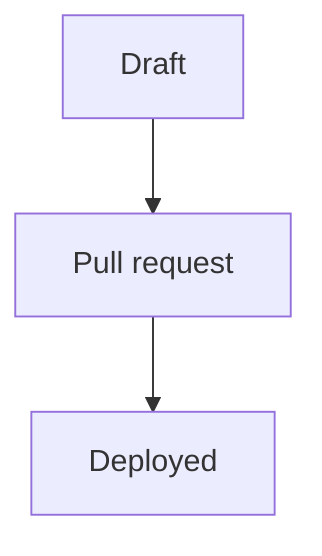
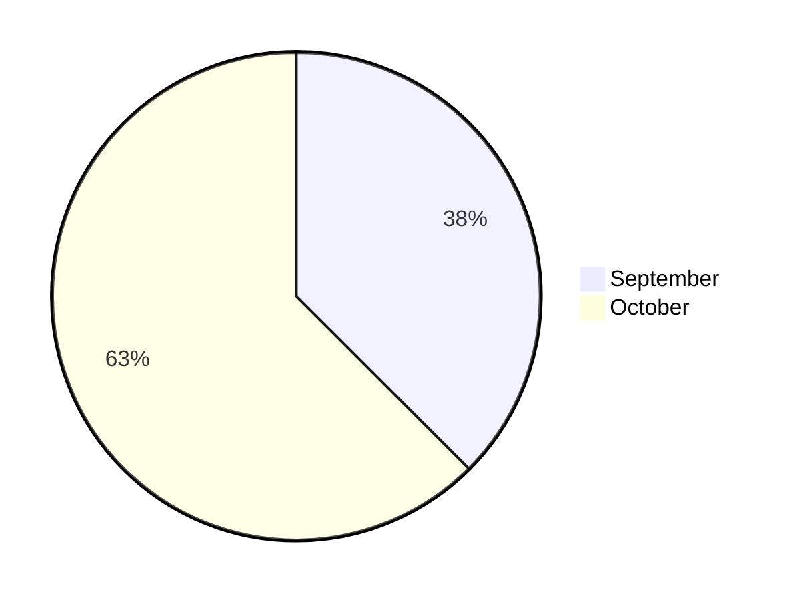

# Contributing

## Posting

1. `just post "Title of the post"` writes `content/writing/<slug>.md` as a draft. The slug is the URL: `/writing/<slug>`.
2. Write the post in Markdown. Run `PUBLIC_SHOW_DRAFTS=1 just dev` and read it at `http://localhost:4321/writing/<slug>`; without the variable, drafts are left out.
3. Set `draft: false` and open a pull request. Cloudflare builds a preview of the site for the branch.
4. Merge. `main` deploys to ayagmar.dev, the feeds and search index included.

Frontmatter:

| Field      | Required | Rule                                                                 |
| ---------- | -------- | -------------------------------------------------------------------- |
| `title`    | yes      | Non-empty.                                                           |
| `date`     | yes      | `YYYY-MM-DD`, the publish date.                                      |
| `updated`  | no       | `YYYY-MM-DD`, not before `date`. Shown as "last updated".            |
| `summary`  | yes      | One sentence. Used in lists, feeds and search.                       |
| `tags`     | no       | Lowercase slugs like `rust` or `home-lab`, no repeats.               |
| `series`   | no       | A lowercase slug shared by the posts of a series.                    |
| `draft`    | no       | `true` keeps the post out of production builds. Defaults to `false`. |
| `projects` | no       | Slugs of the featured projects the post is about, like `[runnerd]`.  |

Any other field fails the build, so a typo such as `sumary:` does not pass silently. The error names the file and the field.

"Last updated" comes from `updated` in the frontmatter. Deriving it from git history is not done yet.

### Diagrams

Write a Mermaid diagram in a `mermaid` code block. It becomes an SVG when the site builds; readers get no JavaScript. Every diagram needs a name for screen readers, given one of two ways:

````md



````

- `accTitle:` names the diagram without showing the name; `accDescr:` adds a longer description.
- `title="..."` after `mermaid` names the diagram and shows the text as a caption below it. It is the only option the code block accepts.

The build fails, naming the file and line, when a diagram has no name, has a Mermaid error or uses an unknown option. Check how it looks with `just dev`. Prefer `flowchart TB` to `LR` once a flowchart has more than three nodes: a wide diagram shrinks on phones, text included. Any diagram type Mermaid 12.1 supports works ([Pele](https://pele.run) renders them); colors come from the site theme, so leave out `style` and `classDef` unless a color carries meaning.

## Projects

The featured projects are listed in `packages/contracts/src/projects.ts`. Each gets a page at `/projects/<slug>` and feeds at `/projects/<slug>/feed.xml` and `atom.xml`. A post with `projects: [<slug>]` shows that project's card and appears on its page.

To describe a project, add `content/projects/<slug>.md`:

```md
---

slug: runnerd
status: active # active, maintained, archived or spec
tagline: 'One line shown under the name.' # optional
subdomain: runnerd # optional: links https://runnerd.ayagmar.dev
order: 1 # optional: lower comes first on /projects
---

The long description, in Markdown.
```

The build fails when `slug` is not a featured project or differs from the file name, and warns about featured projects that have no file.

## Code changes

- Every command is a `just` recipe. CI calls the same recipes.
- Run `just check` and, for anything that changes pages or the site Worker, `just e2e` before opening a pull request.
- The units depend on each other in one direction only (see [ARCHITECTURE.md](ARCHITECTURE.md)). `just boundaries` fails otherwise.
- New dependencies need a line in [docs/adr/0020-dependency-policy.md](docs/adr/0020-dependency-policy.md) and an exact version.
- Record decisions in `docs/adr/` (copy the shape of an existing one).

## CI checks

One workflow, `.github/workflows/ci.yml`, runs on every pull request and on `main`. It runs only the jobs your change needs and a `gate` job that passes when each of them passed; `gate` is the only required check. [ADR 0018](docs/adr/0018-ci.md) lists which paths run which jobs. `just ci-plan` shows the jobs for your branch against `origin/main`.

Each job runs `just` recipes, so you can run the same thing locally. Recipes that need a pinned tool (gitleaks, lychee, osv-scanner, actionlint, zizmor, shellcheck, shfmt) download it into `.tools/bin` on first use (Linux x86_64).

| Job              | Locally                                                                 |
| ---------------- | ----------------------------------------------------------------------- |
| `format`         | `just fmt-check` (`just fmt` fixes it)                                  |
| `secrets-source` | `just scan-secrets-source`                                              |
| `checks`         | `just lint typecheck knip boundaries test-scripts`                      |
| `contracts`      | `just contracts-schema-check test-contracts`                            |
| `site-test`      | `just test-site`                                                        |
| `site-build`     | `just site-build site-dist-check scan-site`                             |
| `e2e`            | `just e2e` (builds first; `just e2e-install` once for Chromium)         |
| `links`          | `just links` after a build (`just links-internal` skips external links) |
| `signals-test`   | `just test-signals signals-build scan-signals`                          |
| `osv`            | `just osv`                                                              |
| `workflows`      | `just workflows-lint ci-test ci-policy`                                 |
| `renovate`       | `just renovate-check`                                                   |
| `shell`          | `just shell-lint`                                                       |
| `codeql`         | CI only                                                                 |

CI never deploys and has no Cloudflare credential. Do not add a workflow step that calls Wrangler or a recipe that deploys; `just ci-policy` fails if you do.

## Commits and merges

- Commit messages follow [Conventional Commits](https://www.conventionalcommits.org): `feat: ...`, `fix: ...`, `docs: ...`, `chore: ...`. Pull request titles use the same form; they are the project history.
- Branches are named `<type>/<topic>`, for example `feat/now-playing`.
- Pull requests are merged with a merge commit. Do not squash.
