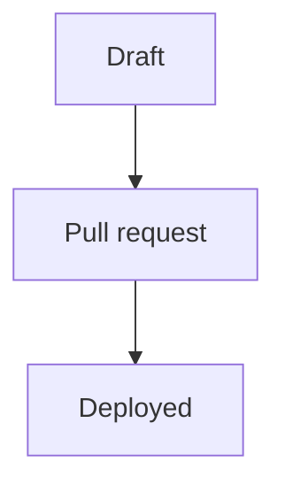
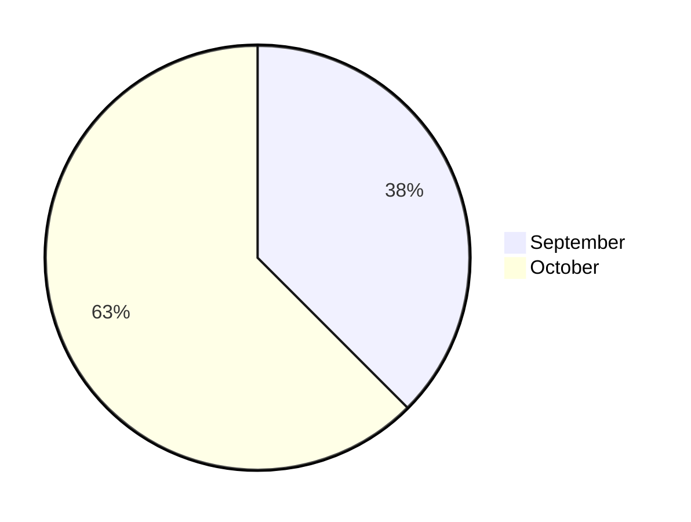

# Contributing

## Posting

1. `just post "Title of the post"` writes `content/writing/<slug>.md` as a draft (the slug is the URL, `/writing/<slug>`), opens it in `$VISUAL` or `$EDITOR` (without `--wait`, so set it to a GUI editor), starts the dev server with drafts shown and opens the page in the browser. The page reloads on every save. If this checkout's dev server with drafts is already on port 4321, it uses that one; anything else there (plain `just dev`, another worktree or project) is refused with what to run. `--no-open` only writes the file.
2. `just drafts` starts the same dev server later and prints the URL of every draft post and note.
3. `just publish <slug>` publishes it. It needs a clean tree apart from that file and a new map of its art ([docs/art.md](docs/art.md)), `HEAD` at `origin/main` and `gh` logged in. It sets `draft: false` and `date` to today in Rabat (`Africa/Casablanca`, from tzdata; `updated` stays as it is), runs `just site-build`, which fails on a bad field or an unnamed diagram (the file goes back to a draft if it does), then commits `content(writing): publish <slug>` on a new branch `content/<slug>`, pushes it and opens a pull request. If the commit fails, the draft and the branch are put back; if the push or the pull request fails, the commit stays and it prints the commands that finish the job. It prints the pull request and the page's Preview URL, `https://content-<slug>-min7-site.ayagmar.workers.dev/writing/<slug>`, live once Workers Builds finishes. A slug over 45 characters is cut short in the branch name so that URL still fits. `--dry-run` runs the checks and prints the steps without changing anything.
4. Merge the pull request. `main` deploys to ayagmar.dev, the feeds and search index included. `just publish` never merges.

Frontmatter:

| Field      | Required | Rule                                                                              |
| ---------- | -------- | --------------------------------------------------------------------------------- |
| `title`    | yes      | Non-empty.                                                                        |
| `date`     | yes      | `YYYY-MM-DD`, the publish date.                                                   |
| `updated`  | no       | `YYYY-MM-DD`, not before `date`. Shown as "last updated".                         |
| `summary`  | yes      | One sentence. Used in lists, feeds and search.                                    |
| `tags`     | no       | Lowercase slugs like `rust` or `home-lab`, no repeats.                            |
| `series`   | no       | A slug a series' posts share; each then shows "Part 2 of 3" and links the others. |
| `draft`    | no       | `true` keeps the post out of production builds. Defaults to `false`.              |
| `projects` | no       | Slugs of the featured projects the post is about, like `[runnerd]`.               |
| `art`      | no       | Art above the title; see below. Posts without it get none.                        |
| `receipts` | no       | The days the post's receipt line counts; see below.                               |

Any other field fails the build, so a typo such as `sumary:` does not pass silently. The error names the file and the field.

A series counts the posts the build shows: published ones in production, drafts too in Previews. A series with one part shown has no line.

`art` draws a figure in dots above the title at build time ([ADR 0027](docs/adr/0027-room-details-and-per-post-art.md)). Name one of the room's objects, or a map file beside the post:

```yaml
art: lamp
art: my-post.art.txt
```

The objects are `lamp`, `notebook`, `monitor`, `record`, `cat`, `window` and `tea`. [docs/art.md](docs/art.md) shows how to make a map.

`receipts` puts one line under the post's header with what the daily history recorded over a range of days, both ends included: PRs merged, commits, agent tokens and the days with any of them.

```yaml
receipts: { from: 2026-10-12, to: 2026-10-26, repos: [ayagmar/runnerd] }
```

`from` and `to` are `YYYY-MM-DD`, `to` not before `from`. `repos` (`owner/name`, optional) picks the repositories whose merges and commits count; without it the post's `projects` count, and without those every repository. Agent tokens are never per repository, so they always count all of that day's use. Shipping counts UTC days and agent usage days in Rabat, each from its own history. A series with no record in the range is left out rather than shown as 0, and the line says when some days in the range have no record. Without `receipts` there is no line; the range is never guessed.

"Last updated" comes from `updated` in the frontmatter. Deriving it from git history is not done yet.

### Diagrams

Write a Mermaid diagram in a `mermaid` code block. It becomes an SVG when the site builds; readers get no JavaScript. Every diagram needs a name for screen readers, given one of two ways:

````md



````

- `accTitle:` names the diagram without showing the name; `accDescr:` adds a longer description.
- `title="..."` after `mermaid` names the diagram and shows the text as a caption below it. It is the only option the code block accepts.

The build fails, naming the file and line, when a diagram has no name, has a Mermaid error or uses an unknown option. Check how it looks with `just dev`. Prefer `flowchart TB` to `LR` once a flowchart has more than three nodes: a wide diagram shrinks on phones, text included. Any diagram type Mermaid 12.1 supports works ([Pele](https://pele.run) renders them); colors come from the site theme, so leave out `style` and `classDef` unless a color carries meaning.

## TIL notes

A note is a short "today I learned" in `content/til/<slug>.md`; the slug is the URL, `/til/<slug>`. `just til "Title"`, `just drafts` and `just publish <slug>` work as for posts, and the commit is `content(til): publish <slug>`. Frontmatter is `title` and `date` (`YYYY-MM-DD`), plus optional `tags` (the posts' rules) and `draft: true`. Any other field, `summary` included, fails the build. The body is a few lines to a few paragraphs of Markdown, with the same code blocks and diagrams as posts. `/til` shows every published note in full, newest first; `/til/feed.xml` and `/til/atom.xml` carry them, and the writing feeds do not. Feeds use the note's first paragraph as its summary. Details: [ADR 0028](docs/adr/0028-til-notes.md).

## Skills

`/skills` shows the public skills in [ayagmar/agents-skills](https://github.com/ayagmar/agents-skills). The page reads `content/skills.json`, never the network or a checkout. After a skill changes there, `just skills-sync --evals ~/projects/agents-skills/eval-results` rewrites the file from the repo's `main` (add `--from <checkout>` to read a local copy instead) and prints a warning for each skill it had to fill in from a fallback. The eval results are not tracked in that repo, so pass them from the local checkout or the shelf loses its eval lines. Commit the file as `chore(content): sync skills`. Details: [ADR 0031](docs/adr/0031-skills-shelf.md).

## Projects

The featured projects are listed in `packages/contracts/src/projects.ts`, strongest first; the home page shows the first five. Each gets a page at `/projects/<slug>` and feeds at `/projects/<slug>/feed.xml` and `atom.xml`. A post with `projects: [<slug>]` shows that project's card and appears on its page.

signals fetches each project's stars, latest release and npm downloads, which costs two subrequests per repository and one per npm package, and the pull must stay at 25 or fewer ([ADR 0009](docs/adr/0009-pull-adapters.md)). The list is at 25. A project whose releases or packages say nothing about the repository as a whole (agents-skills publishes one per skill), or that has neither (kipple, dotfiles), takes `pull: false` and costs nothing; to pull another one, mark one `pull: false` or drop it.

To describe a project, add `content/projects/<slug>.md`:

```md
---

slug: runnerd
status: active # active, maintained, archived or spec
group: self-hosted # agents, desktop or self-hosted: its heading on /projects
tagline: 'One line shown under the name.' # optional
subdomain: runnerd # optional: links https://runnerd.ayagmar.dev
order: 1 # optional: overrides the contracts order, lower first
---

The long description, in Markdown.
```

A project page can show a screenshot under its header ([ADR 0049](docs/adr/0049-project-screenshots.md)). Take it from the project's own repository, never from a capture of your machine, and leave out any that shows another person's name or picture: download the file at a commit into `apps/site/src/assets/projects/` and add an entry to `content/project-screenshots.json`:

```json
{
  "slug": "pi-extmgr",
  "alt": "One sentence on what is on screen.",
  "image": {
    "file": "pi-extmgr.png",
    "source": "https://raw.githubusercontent.com/ayagmar/pi-extmgr/<commit>/docs/assets/installed-workspace.png",
    "fetched": "2026-11-12"
  }
}
```

When the repository has a light and a dark version of the same view, save them as `<slug>-day` and `<slug>-night` and give `day` and `night` in place of `image`; the page shows the one for the theme. Every screenshot opens in the page's image viewer. To replace a screenshot, overwrite the file and update `source` and `fetched`. Run `just budgets` after `just site-build`: every size of both versions counts against the page's 150 KB.

The build fails when `slug` is not a featured project or differs from the file name, and warns about featured projects that have no file.

The Noctalia plugins are not featured projects: they are directories in [noctalia-dev/community-plugins](https://github.com/noctalia-dev/community-plugins), listed after the groups on /projects ([ADR 0047](docs/adr/0047-noctalia-plugins-on-projects.md)). To add one, append it to `content/noctalia-plugins.json` with its directory, the `name` from its `plugin.toml` and one line on what it does. To show its thumbnail, copy its `thumbnail.webp` into `apps/site/src/assets/plugins/<directory>.webp` and add `thumbnail` with the file, the raw URL at a commit and the day you fetched it ([ADR 0048](docs/adr/0048-content-images.md)). To let the thumbnail open the plugin's screenshot, copy its `screenshot.png` into the same folder as `<directory>-screenshot.png` and add `screenshot` with `alt` (one sentence on what is on screen) and `image` with the same three fields ([ADR 0049](docs/adr/0049-project-screenshots.md)).

A certification on /about can show its badge: save the issuer's badge image from its verify page (the Credly badge image, or Oracle's from its certview share page) in `apps/site/src/assets/badges/` and add `badge` with the file, the image's URL and the day you fetched it ([ADR 0048](docs/adr/0048-content-images.md)). Without one it shows the issuer's initial.

## Styling

The design is the late-night room ([ADR 0026](docs/adr/0026-visual-design-late-night-room.md)).

- Colors are tokens in `apps/site/src/styles/base.css`, each a `light-dark(day, night)` pair. Use a token, not a raw color, and check both themes: the switch in the header, or your system's dark mode. `just e2e` runs axe in both.
- A `.panel` or `.paper` is a section of the page, not a box: a hairline (`--rule`) above it, its heading, and space around it ([ADR 0037](docs/adr/0037-quiet-room.md)). Every page but home and /stats sits in one `.column`; lists are quiet rows, logs put the time first. One accent, `--lamp`, for links and the current page; rose only marks sample data. Headings are the serif at 600; JetBrains Mono is for data (dates, numbers, versions, repository names, code), not labels or buttons.
- No `style=""` attributes or inline `<style>`/`<script>`: the CSP blocks them (ADR 0019).
- The home page room is drawn by `apps/site/scripts/scene.py`. Change it, run `just scene`, and move the object's hotspot rectangle in `src/styles/room.css` if the object moved (and `--crop`, the phone's view, if the window or monitor did). Hotspots and the list under the scene come from `src/lib/room.ts`.
- `just room-states` draws every state of the room on one contact sheet, `apps/site/.room-states/sheet.png`: the sky, the late hours, the weather and the moon's phases, in both themes side by side. It drives the built home page, so look at it after changing the scene or `room.css`. It is never shipped.
- The room's details (the window's sky and moon, the lamp after 02:00, the turning record, the `?` keys, the ASCII room for `curl`) are in [ADR 0027](docs/adr/0027-room-details-and-per-post-art.md), with how to see each one. If you move the window in `scene.py`, move `moonDisc` in `src/lib/sky.ts` too.
- Fonts are subsets built by `just fonts`. Add characters to `UNICODES` in `scripts/fonts.py` if a post needs glyphs outside Latin-1 and common punctuation. Both recipes need `uv` (`mise install` provides it).

## Code changes

- Every command is a `just` recipe. CI calls the same recipes.
- Run `just check` and, for anything that changes pages or the site Worker, `just e2e` before opening a pull request.
- The units depend on each other in one direction only (see [ARCHITECTURE.md](ARCHITECTURE.md)). `just boundaries` fails otherwise.
- New dependencies need a line in [docs/adr/0020-dependency-policy.md](docs/adr/0020-dependency-policy.md) and an exact version.
- Record decisions in `docs/adr/` (copy the shape of an existing one).
- Tests and comments follow [AGENTS.md](AGENTS.md); `just check-tests` and `just check-comments` enforce the mechanical part ([ADR 0039](docs/adr/0039-quality-checks.md)).

## CI checks

One workflow, `.github/workflows/ci.yml`, runs on every pull request and on `main`. It runs only the jobs your change needs and a `gate` job that passes when each of them passed; `gate` is the only required check. [ADR 0018](docs/adr/0018-ci.md) lists which paths run which jobs. `just ci-plan` shows the jobs for your branch against `origin/main`.

Each job runs `just` recipes, so you can run the same thing locally. Recipes that need a pinned tool (gitleaks, lychee, osv-scanner, actionlint, zizmor, shellcheck, shfmt) download it into `.tools/bin` on first use (Linux x86_64).

| Job              | Locally                                                                                      |
| ---------------- | -------------------------------------------------------------------------------------------- |
| `format`         | `just fmt-check` (`just fmt` fixes it)                                                       |
| `secrets-source` | `just scan-secrets-source`                                                                   |
| `checks`         | `just lint typecheck knip boundaries check-tests check-comments test-scripts test-producers` |
| `contracts`      | `just contracts-schema-check test-contracts`                                                 |
| `site-test`      | `just test-site`                                                                             |
| `site-build`     | `just site-build site-dist-check scan-site`                                                  |
| `e2e`            | `just e2e` (builds first; `just e2e-install` once for Chromium)                              |
| `links`          | `just links` after a build (`just links-internal` skips external links)                      |
| `signals-test`   | `just test-signals signals-build scan-signals`                                               |
| `osv`            | `just osv`                                                                                   |
| `workflows`      | `just workflows-lint ci-test ci-policy`                                                      |
| `renovate`       | `just renovate-check`                                                                        |
| `shell`          | `just shell-lint`                                                                            |
| `budgets`        | `just budgets` after a build                                                                 |
| `lighthouse`     | `just lighthouse` after a build (`--profile desktop` for one profile)                        |
| `codeql`         | CI only                                                                                      |

Lighthouse runs when a change can affect the built site; add the `lighthouse` label to a pull request to run it anyway. On pull requests from this repository it posts one comment with each page's numbers, base → head, and updates it on every run.

CI never deploys and has no Cloudflare credential. Do not add a workflow step that calls Wrangler or a recipe that deploys; `just ci-policy` fails if you do.

## Performance budgets

Every page has a budget, checked on the built site and failing CI when exceeded. [ADR 0017](docs/adr/0017-testing-and-budgets.md) gives each number its reason; the numbers live in `scripts/budgets.json`.

| Check                                             | Budget                                                                                  |
| ------------------------------------------------- | --------------------------------------------------------------------------------------- |
| JavaScript a page loads, gzip                     | 0 B without islands, 20 KB with islands; the theme script apart, at most 1 KB           |
| Page weight: HTML, CSS, JS, images, gzip for text | 150 KB, fonts excluded                                                                  |
| Fonts, the whole build                            | 200 KB, woff2 only                                                                      |
| Requests to other origins from HTML or CSS        | none: self-host fonts, images and scripts                                               |
| ``                                           | `width` and `height` on every one, as positive whole numbers                            |
| Lighthouse, mobile and desktop (median of 3)      | performance ≥ 0.95, accessibility 1, best practices ≥ 0.95, CLS ≤ 0.01, TBT ≤ 100 ms    |
| Lighthouse LCP                                    | ≤ 2.0 s mobile, ≤ 1.0 s desktop                                                         |
| Against the base branch                           | LCP no worse than +10 % and +200 ms on mobile, +100 ms on desktop; TBT +10 % and +50 ms |

`just site-build` then `just budgets` prints a table per page. `just lighthouse --profile desktop` runs Lighthouse locally on the build (Chromium from `just e2e-install`; about three minutes). To change a budget, edit `scripts/budgets.json` and the reason in ADR 0017 in the same pull request.

## Commits and merges

- Commit messages follow [Conventional Commits](https://www.conventionalcommits.org): `feat: ...`, `fix: ...`, `docs: ...`, `chore: ...`. Pull request titles use the same form; they are the project history.
- Branches are named `<type>/<topic>`, for example `feat/now-playing`.
- Pull requests are merged with a merge commit. Do not squash.
