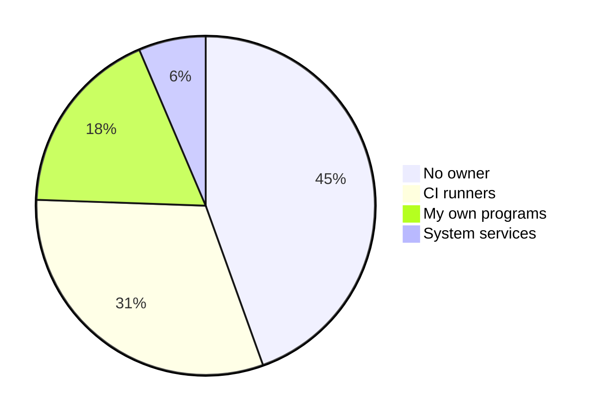

---

title: 'My SSD took 2.5 TiB of writes in 14 hours'
date: 2026-11-15
tags: [linux, ci, btrfs]
art: ssd-2-5-tib-in-14-hours.art.txt
---

My CI runs on my own machine, on the same 1 TB SSD as everything else. Fourteen hours and about 1,100 jobs after boot, the drive had taken 2,512 GiB of writes. That is the whole drive rewritten every five hours.

Linux counts this for you, no root needed. For the whole drive:

```sh
awk '{ printf "%d GiB written, %d GiB discarded\n",
  $7 / 2097152, $14 / 2097152 }' /sys/block/nvme2n1/stat
```

And per group of processes (a cgroup), which tells you who. `259:5` is the drive's number in `lsblk`:

```sh
grep 259:5 /sys/fs/cgroup/*.slice/io.stat
```



Nearly half the writes have no owner. They belong to no group, so Linux itself made them: the file system's own bookkeeping, I think.

Most of it was also pointless. In the same 14 hours the drive was told to forget 1,606 GiB. Two thirds of what gets written is deleted the same day, but only after it has reached the disk.

Part of the cause is caution. Docker and Postgres ask the disk to save each file right now (`fsync`), in case the power goes. In a CI container that is wasted work, because the files are thrown away with the container. So [runnerd](/projects/runnerd) 0.1.2 tells them it's done and skips the work. In a test, that cut a container's writes by a fifth, about 6% of the total.

---

The rest I haven't fixed. I'm still looking, and it's critical. Samsung's warranty is five years or 600 TB written, about a third of a terabyte a day. SMART says this drive took 53.3 TB in its first 245 hours: 5.2 TB a day, and 600 after 115 days.

```mermaid title="TB written by days powered on: my pace (steep), the 600 TB limit (flat), the pace the warranty assumes (bottom)"
xychart-beta
  x-axis "Days powered on" 0 --> 120
  y-axis "TB written" 0 --> 650
  line [0, 104, 209, 313, 418, 522, 626]
  line [600, 600, 600, 600, 600, 600, 600]
  line [0, 7, 13, 20, 26, 33, 39]
```
