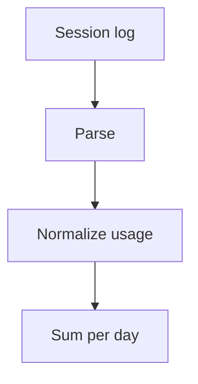

---

title: 'Placeholder: what 17 coding agents taught me about token logs'
date: 2026-10-20
summary: 'Placeholder draft for layout and tests. Session logs, <usage> blocks & the cost of caching.'
tags: [llm, tooling]
projects: [llm-usage-metrics]
receipts: { from: 2026-10-12, to: 2026-10-20 }
art: { kind: ascii, palette: screen }
draft: true
---

**This is a placeholder draft.** Production builds leave it out; the e2e tests read it on the build that shows drafts.

Every coding agent writes its session log differently. Some record a `usage` object per message, some only per session, and a few never record cache reads at all.

```sh
llm-usage --json --since 2026-10-01
```

| Agent       | Log format             |
| ----------- | ---------------------- |
| Claude Code | JSON lines per message |
| Codex       | JSON lines per turn    |

## From log to total

Each log goes through the same three steps before its tokens are added up.



```mermaid title="Placeholder numbers: cache reads per agent, in millions of tokens"
xychart-beta
  x-axis ["Claude Code", Codex, pi]
  y-axis "Million tokens" 0 --> 40
  bar [32, 18, 9]
```
